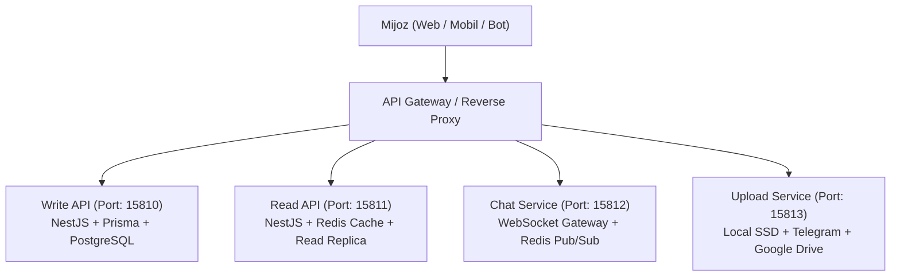
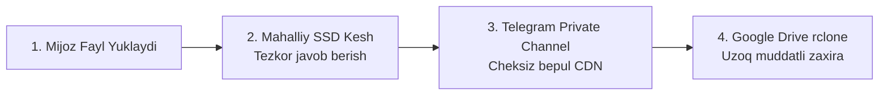

# 🏛️ Safira.uz — Arxitektura Qarorlari va Jamoaviy Ishlash Qo'llanmasi (Team Playbook)

> **Loyiha:** Safira.uz (O'zbekiston hududiy xizmatlar agregatori SaaS platformasi)  
> **Loyiha Rahbari (Senior Team Lead):** Fayzillo Ummatov  
> **Kutilayotgan Start:** 2027-yil Yanvar  
> **Jamoa Hamkorlari:** Nurmuhammad va Backend Muhandislari

---

## 📌 Mundarija
1. [Loyiha Falsafasi va Hozirgi Bosqich](#-1-loyiha-falsafasi-va-hozirgi-bosqich)
2. [Repozitoriylar va Vositalar Ekologiyasi](#-2-repozitoriylar-va-vositalar-ekologiyasi)
3. [To'rt Mikroxizmatli Arxitektura (Portlar Taqsimoti)](#-3-tort-mikroxizmatli-arxitektura-portlar-taqsimoti)
4. [File Upload Service — Gibrid Media Saqlash](#-4-file-upload-service--gibrid-media-saqlash-zero-cost-storage)
5. [AI-Tools (AGY-Tool) — Jamoaviy Vositalar Majmuasi](#-5-ai-tools-agy-tool--jamoaviy-vositalar-majmuasi)
6. [Avtorizatsiya va Guard Standartlari](#-6-avtorizatsiya-va-guard-standartlari)
7. [Ma'lumotlar Bazasi va Prisma Chegaralari](#-7-malumotlar-bazasi-va-prisma-chegaralari)
8. [3-Bosqichli Ish Quvuri (Lab ➔ Dev ➔ Prod)](#-8-3-bosqichli-ish-quvuri-lab--dev--prod)
9. [Dasturchilar Uchun 1-Kungi Onboarding Qadamlari](#-9-dasturchilar-uchun-1-kungi-onboarding-qadamlari)

---

## 🎯 1. Loyiha Falsafasi va Hozirgi Bosqich

Safira.uz — respublika bo'yicha 14 ta hudud (viloyat va shaharlar)dagi barcha servislar, ustalar, xizmat ko'rsatish markazlari va mijozlarni yagona tizimda birlashtiruvchi markazlashgan SaaS platformadir.

### Nega kod bazasida funksiyalar "bo'sh" (Stub / Blueprint)?
Asosiy repozitoriy (`Safira-service-backend`) **ataylab qat'iy arxitektura skeleti** shaklida qurilgan:
- **Kontraktlar barqarorligi:** Frontend va mobil ilovalar uchun barcha API endpointlar, yo'llar (`Controllers`), ma'lumotlar modellari (`DTO`) va baza sxemasi (`Prisma`) oldindan to'liq loyihalashtirilgan.
- **Tartibsizlikdan himoya:** AI yordamchilar va junior dasturchilar o'zboshimchalik bilan arxitekturani o'zgartirmasligi uchun aniq kirish-chiqish qoliplari berilgan.
- **Jamoaning vazifasi:** Ishlab chiquvchilar arxitektura skeletiga teginmasdan, faqatgina `Service` qatlamidagi biznes-mantiqni (DB so'rovlari, validatsiyalar va xatoliklar qaytarish) to'ldiradilar.

---

## 🔗 2. Repozitoriylar va Vositalar Ekologiyasi

Loyihaning barcha qismlari modulli tarzda ajratilgan:

| Komponent | Repozitoriy Havolasi | Vazifasi va Izoh |
| :--- | :--- | :--- |
| 🏗️ **Core Backend (Write API)** | [`Safira-service-backend`](https://github.com/fayzillo95/Safira-service-backend) | Asosiy biznes mantiq, Prisma ORM, Auth va modullar |
| 📁 **File Upload Service** | [`file_upload_service`](https://github.com/fayzillofn30-ai/file_upload_service.git) | Gibrid media kesh, Telegram CDN va Google Drive zaxirasi |
| 🛠️ **AI-Tools (AGY-Tool)** | [`ai-tools`](https://github.com/fummatov92/ai-tools.git) | 0-tokenli deterministik tahlil va kod tekshiruv vositalari |
| 📘 **Architecture Playbook** | [`safira-playbook`](https://github.com/fummatov92/safira-playbook.git) | Jamoaviy qo'llanma va arxitektura qarorlari |

---

## 🧱 3. To'rt Mikroxizmatli Arxitektura (Portlar Taqsimoti)

Serverda xizmatlar o'rtasida to'qnashuv bo'lmasligi uchun **15800–15900** xavfsiz portlar oralig'i qat'iy belgilangan:



- **1️⃣ Write API (Port: `15810`):** Ma'lumotlarni yozuvchi, o'zgartiruvchi asosiy API. Har qanday yaratish (`POST`), yangilash (`PATCH`/`PUT`) va o'chirish (`DELETE`) amallari faqat shu orqali o'tadi.
- **2️⃣ Read API (Port: `15811`):** Yuqori tezlikdagi o'qish xizmati. Asosiy sahifa, qidiruv, 14 ta hudud bo'yicha filtrlash. Redis keshidan foydalanib, 10–20 ms javob tezligini ta'minlaydi.
- **3️⃣ Chat Service (Port: `15812`):** Mijoz va usta/servis o'rtasidagi jonli chat, bildirishnomalar va onlayn holatlar.
- **4️⃣ Upload Service (Port: `15813`):** Foydalanuvchi hujjatlari, avatarlar va xizmat rasmlarini boshqarish.

---

## 📁 4. File Upload Service — Gibrid Media Saqlash (Zero-Cost Storage)

- **Repozitoriy:** [`https://github.com/fayzillofn30-ai/file_upload_service.git`](https://github.com/fayzillofn30-ai/file_upload_service.git)
- **Muammo:** Katta hajmdagi media fayllarni saqlash AWS S3 kabi bulutlarda qimmatga tushadi, kichik VPS diskini esa tez to'ldirib yuboradi.
- **Qabul qilingan arxitektura qarori (Gibrid 3-Bosqichli Saqlash):**



1. **Mahalliy SSD Kesh (`/uploads/`):** Eng so'nggi yuklangan faol rasmlar mahalliy xotirada saqlanadi va darhol uzatiladi.
2. **Telegram Private Channel Storage (`telegram.service.ts`):** Har bir fayl fon rejimida Telegram yopiq kanaliga jo'natiladi. Telegram bergan `file_id` bazaga yoziladi. Bu xizmatga bepul va cheksiz saqlash imkonini beradi.
3. **Google Drive & rclone (`drive_tool.py`):** Loyihaning barcha rasmlari Google Drive hisobiga avtonom sinxronlanadi. Disk buzilgan yoki tozalangan taqdirda fayllar avtomatik ravishda Drive'dan tiklanadi (*lazy-load recovery*).

---

## 🛠️ 5. AI-Tools (AGY-Tool) — Jamoaviy Vositalar Majmuasi

- **Repozitoriy:** [`https://github.com/fummatov92/ai-tools.git`](https://github.com/fummatov92/ai-tools.git)
- **Falsafasi:** Kod tahlili, struktura ko'rish, xavfsizlik skaneri va xatolarni aniqlashda tashqi API'larga murojaat qilmasdan, 0-token sarfi bilan lokal deterministik tezlikda ishlash.

### 💻 Jamoa A'zolari Uchun 5 Ta Kundalik Buyruq:

```bash
# 1. Kod strukturasini ochmasdan, AST daraxti orqali ko'rish:
agy-tool code symbols --path src/modules/region/region.service.ts

# 2. Modul ichidagi barcha API endpointlarni chiqarish:
agy-tool code endpoints src/modules/auth/

# 3. Git'ga commit qilishdan oldin kodda parol yoki sir qolib ketmaganini tekshirish:
agy-tool secure scan .

# 4. Serverdagi bo'sh va band portlarni tekshirish:
agy-tool sys ports --start 15800 --end 15900

# 5. Sintaksis va TypeScript xatoliklarini tezkor tekshirish:
agy-tool debug check src/
```

---

## 🛡️ 6. Avtorizatsiya va Guard Standartlari

Backendda barcha yo'llarni birdaniga qulflab qo'yish yoki noto'g'ri guard qo'llash qat'iyan taqiqlangan.

- **Standart ochiq yo'llar:** Barcha GET (ko'rish) so'rovlari standart bo'yicha ochiq bo'ladi va `@Public()` dekoratori bilan belgilanadi:
  ```typescript
  @Public()
  @Get()
  findAll() { ... }
  ```
- **Foydalanuvchi konteksti zarur yo'llar:** Faqat joriy foydalanuvchi aniqlanishi shart bo'lgan joylarda (masalan: `/profile/me`, `orders`, `my-services`) `JwtAuthGuard` qo'yiladi:
  ```typescript
  @UseGuards(JwtAuthGuard)
  @Get('me')
  findMyProfile(@CurrentUser('id') userId: string) { ... }
  ```
- **Admin huquqlari:** Faqat tizim ma'muri uchun ochiq bo'lgan yo'llarda `@Roles('ADMIN')` va `@UseGuards(RoleGuard)` birgalikda qo'llaniladi.

---

## 🗄️ 7. Ma'lumotlar Bazasi va Prisma Chegaralari

- 🚫 **`prisma/schema.prisma` ga teginish taqiqlanadi:** Sxemani o'zboshimchalik bilan o'zgartirish yoki migratsiya yurgizish taqiqlanadi. Har qanday yangi maydon Team Lead bilan kelishiladi.
- 📍 **Viloyatlar:** O'zbekistonning 14 ta hududi (viloyatlar, Qoraqalpog'iston Respublikasi va Toshkent shahri) allaqachon ma'lumotlar bazasiga to'liq seed qilingan.
- 🔑 **UUID standarti:** Barcha ID kalitlar `String` (UUID v4) shaklida. Controllerlarda `+id` deb raqamga o'girish xato hisoblanadi.

---

## 🔄 8. 3-Bosqichli Ish Quvuri (Lab ➔ Dev ➔ Prod)

Loyiha barqarorligini ta'minlash uchun qat'iy 3 bosqichli sikl amal qiladi:

```
[1. Lab: AI Sandbox] 
       ⬇️ (Tekshirilgan kod)
[2. Dev: Nurmuhammad & Jamoa PR] 
       ⬇️ (Team Lead audit & Code Review)
[3. Production: Safira.uz Jonli Server]
```

- **Lab (Tajriba hududi):** Yangi eksperimental xususiyatlar laboratoriya botida (`@verry_menegment_todo_bot`) sinovdan o'tkaziladi.
- **Dev (Ishlab chiquvchilar hududi):** Jamoa a'zolari o'z modulini Git branch'ida yozib, `ai-tools` orqali tekshirib, PR (Pull Request) ochadi.
- **Prod (Jonli tizim):** Faqat Team Lead (Fayzillo) tomonidan review qilinib, muvaffaqiyatli testlardan so'ng asosiy repozitoriyga birlashtiriladi.

---

## 🚀 9. Dasturchilar Uchun 1-Kungi Onboarding Qadamlari

Jamoaga yangi qo'shilgan muhandis (Nurmuhammad yoki boshqa a'zo) quyidagi qadamlarni bajaradi:

1. **Repozitoriylarni klonlash:**
   ```bash
   git clone https://github.com/fayzillo95/Safira-service-backend.git
   git clone https://github.com/fummatov92/ai-tools.git
   git clone https://github.com/fayzillofn30-ai/file_upload_service.git
   ```
2. **AI-Tools ni o'rnatish:**
   ```bash
   cd ai-tools
   pip install -e .
   agy-tool --help
   ```
3. **Backend bog'liqliklarini o'rnatish va tekshirish:**
   ```bash
   cd ../Safira-service-backend
   npm install
   agy-tool debug check src/
   ```
4. **Vazifani boshlash:** Team Lead tomonidan ajratilgan modul (masalan: `RegionService`) ichidagi bo'sh metodlarni Prisma so'rovlari bilan to'ldirish va PR ochish.
