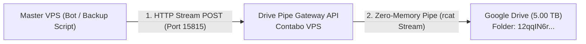

# ☁️ VPS Papka Sinxronizatsiyasi va Google Drive Pipe Gateway API Qo'llanmasi

> **Hujjat Maqsadi:** Ushbu qo'llanma VPS muhitidagi papkalarni Google Drive bilan xavfsiz va yuqori tezlikda sinxronlashtirish texnologiyasini hamda Master VPS uchun Google Drive'ga yo'naltiruvchi maxsus tranzit **Pipe Gateway API** arxitekturasini to'liq yoritib beradi.  
> **Mo'ljallangan Auditoriya:** Master VPS botlari, tizim ma'murlari va backend dasturchilar.

---

## 📌 Mundarija
1. [VPS Desktop Papkasi Qanday Sinxronizatsiya Qilindi?](#-1-vps-desktop-papkasi-qanday-sinxronizatsiya-qilindi)
2. [Qo'llanilgan Qat'iy Ignore Filtrlari (Zero-Waste & Zero-Leak)](#-2-qollanilgan-qatiy-ignore-filtrlari)
3. [Maxsus Google Drive Papkasi Bilan Ulanish (`12qqIN6r...`)](#-3-maxsus-google-drive-papkasi-bilan-ulanish)
4. [Master VPS uchun Drive Pipe Gateway API Arxitekturasi](#-4-master-vps-uchun-drive-pipe-gateway-api-arxitekturasi)
5. [Pipe Gateway API Kontraktlari va Endpointlar](#-5-pipe-gateway-api-kontraktlari-va-endpointlar)
6. [Master VPS dan Foydalanish Kod Namunalari (Curl, Python, Node.js)](#-6-master-vps-dan-foydalanish-kod-namunalari)

---

## 🚀 1. VPS Desktop Papkasi Qanday Sinxronizatsiya Qilindi?

VPS serverdagi `/home/fayzillo/Desktop` papkasi Google Drive'ga (`gdrive:Desktop/`) to'liq o'zining tabiiy jildlar tuzilmasi (iyerarxiyasi) bilan uzatildi.

### Muammo:
- Dastlabki Desktop papkasi hajmi **3.43 GB** va fayllar soni **86,332 ta** edi.
- Ushbu fayllarning 95% qismini qayta tiklanuvchi og'ir virtual muhitlar (`xtts_env`, `openvoice_env`) va `node_modules` tashkil qilgan.
- 86 mingta faylni Google Drive'ga to'g'ridan-to'g'ri tashlash API cheklovlari (Rate Limits) tufayli **8–10 soat** vaqt olgan bo'lardi.

### Yechim va Natija:
- Maxsus `--exclude-from` filtri ishlab chiqildi.
- Hajm **319.38 MB** ga, fayllar soni esa **3,160 ta** toza faylga qisqartirildi.
- Barcha haqiqiy loyihalar, arxitektura rejalari, botlar, konfiguratsiyalar va kodlar **100% to'liq** va xatosiz Google Drive'ga o'tkazildi.

### Ijro Buyrug'i:
```bash
rclone sync /home/fayzillo/Desktop gdrive:Desktop \
  --exclude-from /path/to/drive_sync_exclude.txt \
  --fast-list \
  --transfers 4 \
  --checkers 8 \
  --stats 5s -v
```

---

## 🛡️ 2. Qo'llanilgan Qat'iy Ignore Filtrlari

Sinxronizatsiyada maxfiy ma'lumotlar sizib chiqmasligi (Zero Secret Leak) va tizim og'irlashmasligi uchun quyidagi qat'iy qoidalar fayli (`drive_sync_exclude.txt`) ishlatildi:

```ini
# 1. Paketlar va Og'ir Virtual Muhitlar
**/node_modules/**
**/*_env/**
**/venv/**
**/env/**
**/__pycache__/**
**/.cache/**
**/.npm/**
**/.pytest_cache/**
**/.mypy_cache/**

# 2. Kompilyatsiya va Build Chiqindilari
**/dist/**
**/build/**
**/.next/**
**/out/**
**/*.tsbuildinfo
**/*.pyc
**/*.pyo

# 3. Maxfiy Ma'lumotlar va Kalitlar (Zero-Leak)
**/.env
**/.env.*
**/*.pem
**/*.key
**/*token*
**/*credential*
**/*secret*
**/id_rsa*
**/.git-credentials
**/*.p12
**/gdrive_service_account.json
**/gdrive_oauth_client.json

# 4. Vaqtinchalik Media va Test Fayllari
temp/**
**/temp/**
**/tmp/**
**/*.tmp
**/*.log
**/*.bin
**/*.wav
**/*.mp3
**/*.ogg
**/*.mp4
**/*.avi
**/*.mkv
**/media_artifacts/**
**/super_media_artifacts/**
**/voice_test/**
```

---

## 📂 3. Maxsus Google Drive Papkasi Bilan Ulanish (`Master vps`)

Foydalanuvchi taqdim etgan Google Drive papkasi:
- **Papka Nomi:** `Master vps`
- **Papka IDsi:** `12qqIN6rSpTZGHt3vcpet5sg99w7pWcAV`
- **To'liq havola:** `https://drive.google.com/drive/folders/12qqIN6rSpTZGHt3vcpet5sg99w7pWcAV`

Ushbu papka aynan **Master VPS** ma'lumotlari uchun maxsus ochilgan bo'lib, Worker VPS dagi ma'lumotlar bilan hech qanday to'qnashuv bo'lmaydi. Worker VPS o'z zaxirasini alohida `Worker vps` papkasiga saqlaydi, Master VPS esa to'g'ridan-to'g'ri ushbu `12qqIN6r...` papkasi ichiga o'zining `Desktop/` va `Downloads/` jildlarini joylashtiradi.

### Master VPS da to'g'ridan-to'g'ri bog'lash usuli:
```bash
# 1. Master VPS Desktop papkasini sinxronlash:
rclone sync /home/fayzillo/Desktop gdrive:Desktop \
  --drive-root-folder-id 12qqIN6rSpTZGHt3vcpet5sg99w7pWcAV \
  --exclude-from drive_sync_exclude.txt \
  --transfers 4 --checkers 8 -v

# 2. Master VPS Downloads (Brains) papkasini sinxronlash:
rclone sync /home/fayzillo/Downloads gdrive:Downloads \
  --drive-root-folder-id 12qqIN6rSpTZGHt3vcpet5sg99w7pWcAV \
  --exclude-from drive_sync_exclude.txt \
  --transfers 4 --checkers 8 -v
```

---

## 🔌 4. Master VPS uchun Drive Pipe Gateway API Arxitekturasi

Agar Master VPS da Google Drive Service Account yoki rclone konfiguratsiyasini saqlashni xohlamasangiz, ushbu Contabo VPS (AI Core Engine) tranzit **Drive Pipe Gateway API** sifatida xizmat qiladi.



### Pipe Arxitekturasining Asosiy Ustunliklari:
1. **Zero-RAM Overhead (Striming):** Fayllar Gateway server diskida yoki xotirasida (RAM) vaqtincha saqlanmaydi. Kelayotgan HTTP baytlar oqimi to'g'ridan-to'g'ri Google Drive API ga tranzit tarzda yo'naltiriladi (`req.pipe()`).
2. **Xavfsiz Tranzit:** Master VPS va Gateway o'rtasida `Bearer Token` autentifikatsiyasi orqali himoyalanadi.
3. **Avtonom Target tanlash:** Master VPS har bir so'rovda qaysi papkaga (`X-Folder-Id` yoki `X-Remote-Path`) tushishi kerakligini o'zi belgilay oladi.

---

## 📑 5. Pipe Gateway API Kontraktlari va Endpointlar

- **Xizmat Porti:** `15815` (Contabo VPS dagi xavfsiz 15800–15900 oralig'ida)
- **Asosiy URL:** `http://<CONTABO_SERVER_IP>:15815/api/v1/drive`
- **Xavfsizlik 1-Bosqichi (IP Whitelist):** Faqat ruxsat etilgan VPS IP-manzillaridan kelgan so'rovlar qabul qilinadi. Boshqa har qanday IP-manzildan kelgan so'rov darhol `403 Forbidden` bilan bloklanadi.
- **Ruxsat Berilgan IP-manzillar Fayli:** `/home/fayzillo/Desktop/agy_tasks/drive_pipe_gateway/config/allowed_ips.json`
- **Xavfsizlik 2-Bosqichi (Bearer Token):** `Authorization: Bearer <SECURE_PIPE_SECRET>`

### 1️⃣ `POST /api/v1/drive/pipe-upload`
Fayl yoki ma'lumotlar oqimini to'g'ridan-to'g'ri Google Drive ga yuklaydi.

**Headers:**
- `Authorization: Bearer <SECURE_PIPE_SECRET>`
- `X-Folder-Id: 12qqIN6rSpTZGHt3vcpet5sg99w7pWcAV` (Ixtiyoriy, default papka mavjud)
- `X-Remote-Path: master_backups/database_2026.sql` (Drive dagi saqlanish yo'li)
- `Content-Type: application/octet-stream` (yoki fayl turi)

**Response (JSON):**
```json
{
  "success": true,
  "status": "piped_to_drive",
  "folder_id": "12qqIN6rSpTZGHt3vcpet5sg99w7pWcAV",
  "remote_path": "master_backups/database_2026.sql",
  "size_bytes": 10485760,
  "size_formatted": "10.00 MB",
  "duration_seconds": 1.45,
  "timestamp": "2026-10-23T11:50:00Z"
}
```

### 2️⃣ `GET /api/v1/drive/status`
Google Drive kvotasi, ulanish holati va Pipe Gateway sog'lig'ini tekshiradi.

**Response (JSON):**
```json
{
  "success": true,
  "gateway_status": "online",
  "port": 15815,
  "drive_connection": "live",
  "quota": {
    "total": "5.00 TB",
    "used": "519.38 MB",
    "free": "5.00 TB"
  }
}
```

### 3️⃣ `POST /api/v1/drive/trigger-sync`
Master VPS dan belgilangan papka yoki yo'nalish bo'yicha fon rejimida to'liq sinxronizatsiyani ishga tushirish.

---

## 💻 6. Master VPS dan Foydalanish Kod Namunalari

### A) Bash / Curl orqali (Bitta qatorli zaxiralash):
```bash
# PostgreSQL yoki faylni to'g'ridan-to'g'ri Google Drive ga uzatish:
pg_dump mydb | curl -X POST "http://<CONTABO_SERVER_IP>:15815/api/v1/drive/pipe-upload" \
  -H "Authorization: Bearer <SECURE_PIPE_SECRET>" \
  -H "X-Folder-Id: 12qqIN6rSpTZGHt3vcpet5sg99w7pWcAV" \
  -H "X-Remote-Path: db_backups/mydb_$(date +%F).sql" \
  --data-binary @-
```

### B) Python (Master Bot orqali yuklash):
```python
import requests

def upload_to_drive_pipe(file_path: str, remote_filename: str):
    gateway_url = "http://<CONTABO_SERVER_IP>:15815/api/v1/drive/pipe-upload"
    headers = {
        "Authorization": "Bearer <SECURE_PIPE_SECRET>",
        "X-Folder-Id": "12qqIN6rSpTZGHt3vcpet5sg99w7pWcAV",
        "X-Remote-Path": f"bot_data/{remote_filename}",
        "Content-Type": "application/octet-stream"
    }

    with open(file_path, "rb") as f:
        response = requests.post(gateway_url, headers=headers, data=f, timeout=300)
    
    return response.json()

# Ishlatish:
res = upload_to_drive_pipe("/var/backups/report.pdf", "report.pdf")
print("Drive ga uzatildi:", res)
```

### C) Node.js (Stream Pipe orqali):
```javascript
const fs = require('fs');
const http = require('http');

function pipeFileToDrive(localPath, remotePath) {
  const fileStream = fs.createReadStream(localPath);
  
  const req = http.request({
    hostname: '<CONTABO_SERVER_IP>',
    port: 15815,
    path: '/api/v1/drive/pipe-upload',
    method: 'POST',
    headers: {
      'Authorization': 'Bearer <SECURE_PIPE_SECRET>',
      'X-Folder-Id': '12qqIN6rSpTZGHt3vcpet5sg99w7pWcAV',
      'X-Remote-Path': remotePath,
      'Content-Type': 'application/octet-stream'
    }
  }, (res) => {
    let data = '';
    res.on('data', chunk => data += chunk);
    res.on('end', () => console.log('Natija:', JSON.parse(data)));
  });

  fileStream.pipe(req);
}

// Ishlatish:
pipeFileToDrive('/app/data/export.zip', 'archives/export.zip');
```
